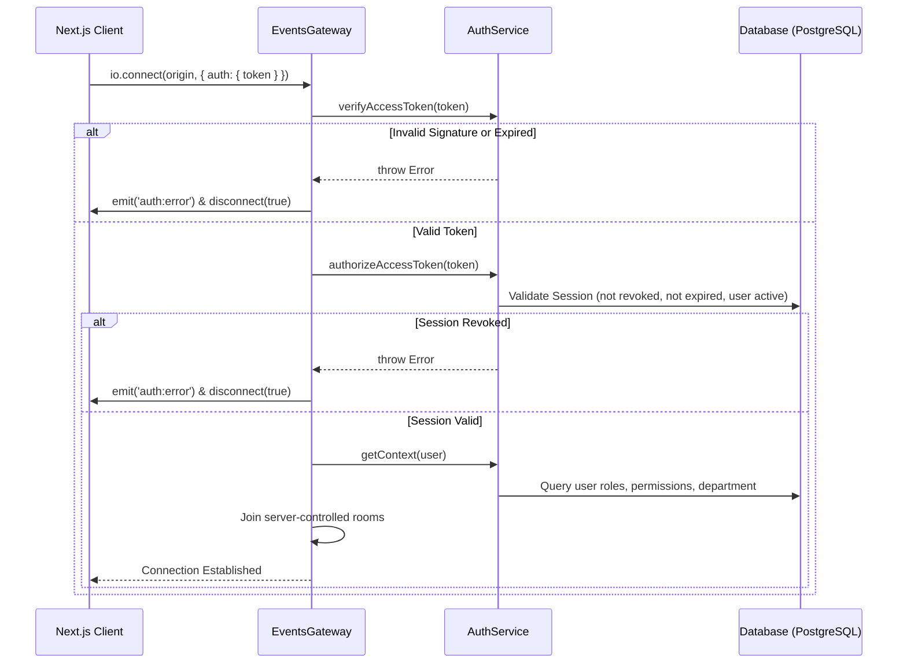

# CampusOS WebSocket Architecture & Real-Time Events

CampusOS uses a centralized WebSocket layer powered by NestJS WebSockets (`@nestjs/websockets`, `@nestjs/platform-socket.io`) and `socket.io-client` on the Next.js frontend to deliver secure, tenant-isolated real-time updates.

---

## 1. Core Principles

1. **REST as Source of Truth**: All state mutations occur through validated REST API endpoints. WebSocket connections are used exclusively for server-originated notification and push events.
2. **Handshake Authentication**: Sockets are authenticated during the initial connection handshake. Unauthenticated or invalid connections are rejected and disconnected immediately.
3. **Zero Trust of Client Context**: Sockets never accept `collegeId`, `departmentId`, or `role` claims from client payloads or query parameters. Identity, tenant context, and room assignments are derived exclusively from verified JWT access tokens and database sessions.
4. **Strict Tenant & Department Isolation**: Rooms are namespaced by `collegeId` and `departmentId`. Cross-tenant event leakage is architecturally prohibited.
5. **Post-Commit Emission**: Domain events are emitted strictly **after** successful database transactions. Failed operations never emit optimistic or false success events.

---

## 2. Room Architecture

All room joins occur server-side inside `EventsGateway.joinAuthorizedRooms()` upon successful handshake authentication:

| Room Pattern | Purpose | Who Joins |
|---|---|---|
| `college:{collegeId}` | College-wide broadcasts and administrative event tracking | All authenticated users in the college |
| `user:{userId}` | Targeted direct notifications (e.g. task assignment, review outcome) | The specific authenticated user |
| `role:{collegeId}:{role}` | Role-specific alerts (e.g. `role:c1:FACULTY`, `role:c1:HOD`) | Users holding that role in the college |
| `department:{collegeId}:{departmentId}` | Departmental operations (e.g. departmental tasks, approvals) | Faculty and HOD assigned to that department |

Clients cannot request or leave rooms arbitrarily. The Socket.IO gateway handles all room assignments based on the server-resolved `AuthorizationContext`.

---

## 3. Handshake & Authentication Flow



---

## 4. Supported Events & Payloads

### Task Events (`TASK_EVENTS`)

| Event Name | Trigger | Target Rooms | Payload Summary |
|---|---|---|---|
| `task:created` | Task created by Admin/HOD | `college:{collegeId}`, `department:{collegeId}:{deptId}` | Task details, creator, priority, deadline |
| `task:assigned` | Task assigned to faculty/HOD | `user:{assigneeUserId}`, `college:{collegeId}` | Task details, assignment ID, assignee ID |
| `task:started` | Assignee marks task `IN_PROGRESS` | `college:{collegeId}`, `user:{actorUserId}` | Task details, assignment ID, status |
| `task:submitted`| Assignee submits completed work | `college:{collegeId}`, `department:{collegeId}:{deptId}` | Task details, submission preview |
| `task:reviewed` | Manager approves or requests rework | `user:{assigneeUserId}`, `college:{collegeId}` | Review decision (`APPROVED`/`REWORK`), feedback |
| `task:updated`  | Task metadata modified | `college:{collegeId}`, `department:{collegeId}:{deptId}` | Updated task details |

### Payload Structure (`TaskEventPayload`)

```typescript
export type TaskEventPayload = {
  taskId: string;
  title: string;
  status: string;
  priority: string;
  departmentId: string | null;
  assignmentId?: string;
  actorUserId: string;
  actorName: string;
  assigneeUserId?: string;
  summary: string;
  timestamp: string; // ISO 8601
};
```

---

## 5. Frontend Client & Hook Integration

### Client Singleton (`apps/web/src/lib/socket.ts`)
- Lazy socket instantiation via `getSocket()`.
- Access token read directly from session storage (`campusos_access_token`).
- Configured with exponential reconnection backoff (1s initial, 30s max, 10 attempts).
- `disconnectSocket()` terminates socket and removes listeners on logout.

### React Hooks (`apps/web/src/lib/use-socket.ts`)
```tsx
import { useTaskEvents, TASK_EVENTS } from '@/lib/use-socket';

export function MyComponent() {
  useTaskEvents(
    [TASK_EVENTS.CREATED, TASK_EVENTS.ASSIGNED, TASK_EVENTS.SUBMITTED],
    (event, payload) => {
      // Re-fetch or refresh UI seamlessly
      refreshData();
    },
  );
}
```

### UI Integration Touchpoints
- **Task Management List** (`/dashboard/tasks`): Live refresh of tasks and assignment tables upon task events.
- **Task Detail View** (`/dashboard/tasks/[id]`): Targeted live update when the viewed task is assigned, submitted, or reviewed.
- **Admin Dashboard** (`/dashboard`): Task workflow stat counters refresh live without full-page reloads.
- **HOD Dashboard** (`/dashboard`): Departmental task lists and counters refresh immediately.
- **Faculty Dashboard** (`/dashboard`): "My Tasks" assignment list and status counters refresh on assignment or review.

---

## 6. Testing & Validation

Backend unit tests cover:
- Gateway authentication failures (missing token, invalid token, revoked session).
- Room assignment verification (college, user, role, department rooms).
- Multi-tenant boundary verification (ensuring tenant A sockets cannot receive tenant B room assignments).
- Post-commit event emissions in domain services.
- Suppression of event emissions during database rollbacks.
